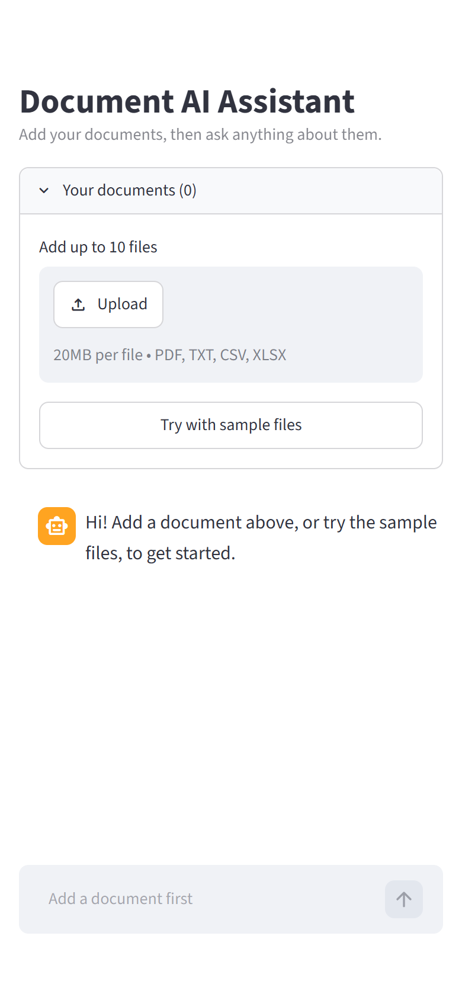
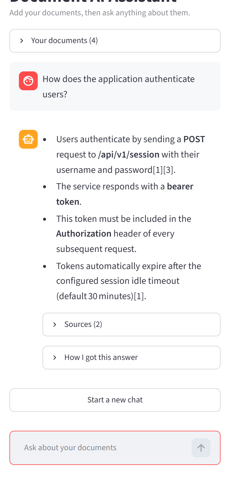
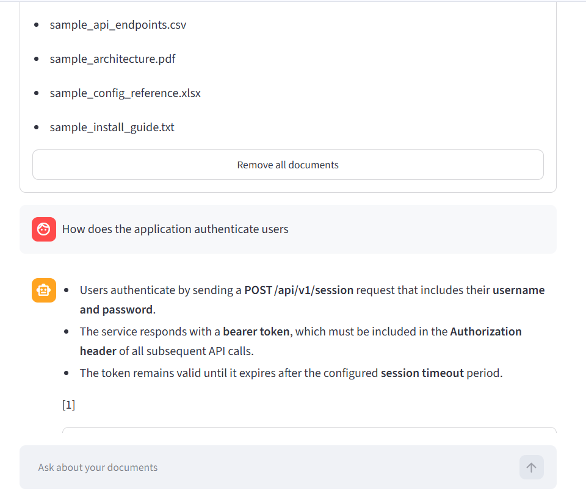
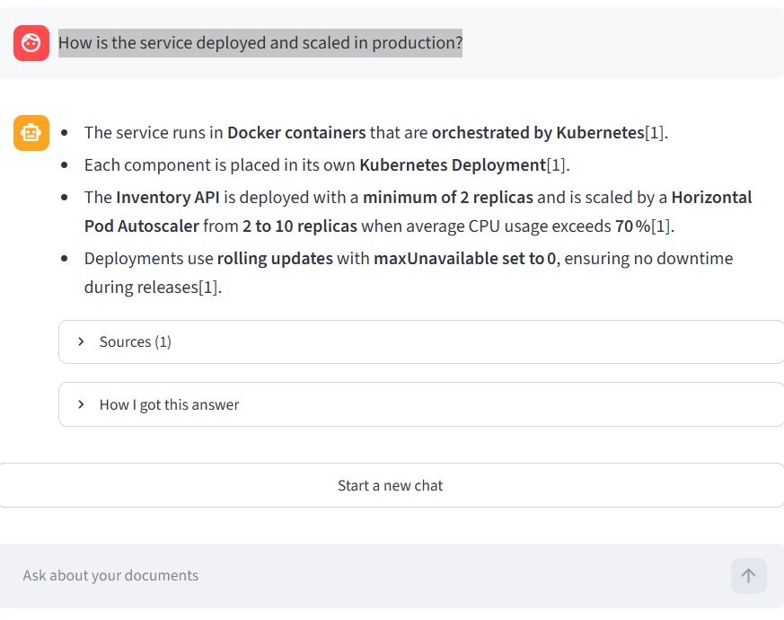
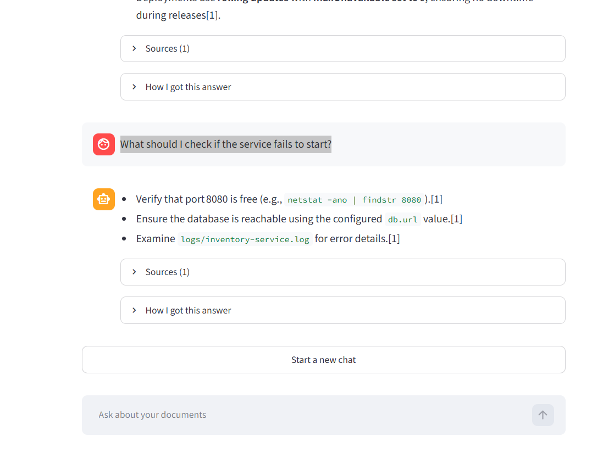
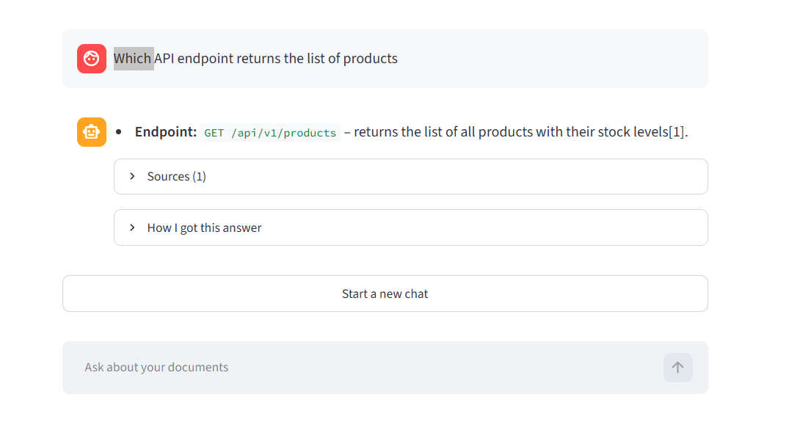
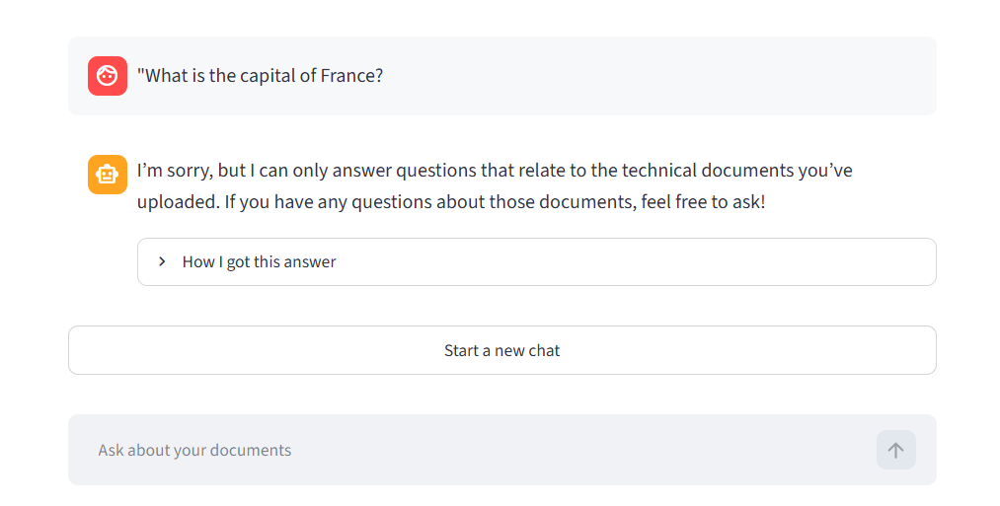
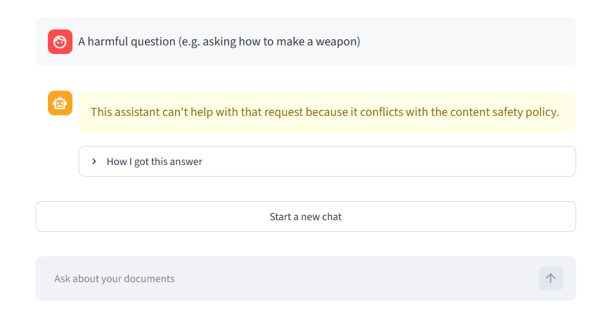

# Document AI Assistant

Upload your documents and ask questions about them in plain English. A team of AI agents finds the relevant parts, writes an answer, checks it against your documents, and shows you the sources.

Capstone project for the Generative AI and ML program. Full details are in [docs/DOCUMENTATION.md](docs/DOCUMENTATION.md).

<p>
  
  
</p>

## Quick start (Windows PowerShell)

You need Python 3.13 and a free [Groq API key](https://console.groq.com).

> **Unzip to a short folder**, such as `C:\projects\document-ai-assistant`. Windows limits file paths to 260 characters, and a deeply nested folder makes `pip install` fail with `OSError: [Errno 2] No such file or directory`.

```powershell
cd C:\projects\document-ai-assistant
python --version                 # should print Python 3.13.x
python -m venv .venv
.\.venv\Scripts\Activate.ps1     # if blocked: Set-ExecutionPolicy -Scope Process RemoteSigned
pip install -r requirements.txt  # takes about 5-10 minutes
Copy-Item .env.example .env
notepad .env                     # replace your-groq-api-key-here with your key, then save
python start_app.py
```

The app opens at http://localhost:8501. The first time it starts, it shows "Getting things ready..." for about 30 seconds while it loads the AI models and downloads a small embedding model (about 90 MB). Later starts are faster.

Without a real key, uploading still works, but the app shows a warning and doesn't answer questions.

To stop the app, press `Ctrl+C` in the terminal.

### macOS / Linux

The app was built and tested on Windows 11. On macOS or Linux, the same steps are:

```bash
cd ~/projects/document-ai-assistant
python3 --version                # should print Python 3.13.x
python3 -m venv .venv
source .venv/bin/activate
pip install -r requirements.txt
cp .env.example .env             # edit .env and replace your-groq-api-key-here with your key
python start_app.py
```

### Troubleshooting

| Problem | Fix |
|---|---|
| The page stays blank | Wait about 30 seconds on the first start, then press `Ctrl+F5`. Check the terminal for errors. |
| `No module named ...` | The virtual environment isn't active. Run `.\.venv\Scripts\Activate.ps1` (on macOS/Linux, `source .venv/bin/activate`), then start the app again. |
| `No such file or directory: '...app.py'` | Start the app with `python start_app.py`, not `streamlit run app.py`. |
| The app opened on port 8502 instead of 8501 | Another copy is already using port 8501. Open the URL printed in the terminal, or close the other copy. |
| "Answers are switched off because GROQ_API_KEY is missing" | Put your real key in `.env`, then restart the app. |
| `The LLM API key is invalid or expired` | Check the key in `.env`. You can create a new one at https://console.groq.com. |

## How to use it

1. Tap **Try with sample files**, or upload your own PDF, TXT, CSV, or Excel (`.xlsx`) files. They're processed automatically.
2. Type a question in the box at the bottom.
3. Read the answer. Numbers like `[1]` match the entries under **Sources**.
4. Open **How I got this answer** to see each step the agents took.

## Sample files

These are in `data/sample_documents/` and describe a made-up "Acme Inventory Service".

| File | Type | Contents |
|---|---|---|
| `sample_architecture.pdf` | PDF | Components, deployment, and scaling |
| `sample_install_guide.txt` | Text | Installation, authentication, and troubleshooting |
| `sample_api_endpoints.csv` | CSV | REST API endpoints |
| `sample_config_reference.xlsx` | Excel | Configuration settings and error codes |

`data/sample_documents/invalid/` has broken files for testing error messages, such as `fake.pdf`.

## Sample output to expect

The wording changes a little each time because answers come from an LLM. The key points should stay the same.

| Ask this | Expect this |
|---|---|
| How does the application authenticate users? | Send a POST request to `/api/v1/session` with a username and password. You get a bearer token to send in the `Authorization` header. Cites the install guide. |
| How is the service deployed and scaled in production? | Docker containers on Kubernetes, at least 2 replicas of the Inventory API, autoscaling up to 10 replicas above 70% CPU, and rolling updates. Cites the architecture PDF. |
| What should I check if the service fails to start? | Check that port 8080 is free, that the database is reachable through `db.url`, and the log file `logs/inventory-service.log`. |
| Which API endpoint returns the list of products? | `GET /api/v1/products`. Cites the API endpoints CSV. |
| Which documents do you have? | A list of the 4 sample files. |
| What is the capital of France? | No answer from general knowledge. It says it only answers questions about your documents, or that they don't contain the information. |
| Uploading `invalid/fake.pdf` | The message `fake.pdf: File content is not a valid PDF.` Any other files in the same upload still work. |

A full answer looks like this:

```text
You:  How is the service deployed and scaled in production?

App:  - The service runs as Docker containers managed by Kubernetes [1]
      - Each component is placed in its own Kubernetes Deployment [1]
      - The Inventory API is deployed with a minimum of 2 replicas [1]
      - A Horizontal Pod Autoscaler can increase the Inventory API from
        2 to 10 replicas when average CPU usage exceeds 70% [1]
      - Updates are performed as rolling updates with maxUnavailable
        set to 0, ensuring no downtime during deployments [1]

      Sources (1)
      How I got this answer
```

## How to test it

### Automated tests

```powershell
python -m pytest
```

Expected result: `198 passed`. Without an API key, it's `185 passed, 13 skipped` instead, because the tests that call the live LLM are skipped.

### Manual checks in the app

Tap **Try with sample files** first. **Positive checks:** ask the questions in [Sample output to expect](#sample-output-to-expect) above.

**Negative checks:** upload these files from `data/sample_documents/invalid/`, or do the action shown.

| Do this | Expect this |
|---|---|
| Upload `fake.pdf` | `fake.pdf: File content is not a valid PDF.` |
| Upload `scanned.pdf` | `scanned.pdf: No extractable text: the PDF may be scanned or image-only.` |
| Upload `corrupt.xlsx` | `corrupt.xlsx: Excel file is corrupt or cannot be read.` |
| Upload `empty.txt` | `empty.txt: File is empty.` |
| Upload any `.docx` or image file | `Unsupported file type '.docx'. Supported: .csv, .pdf, .txt, .xlsx.` |
| Upload `injection_test.txt`, then ask "What is the cache time-to-live?" | `300 seconds`. The file contains a hidden instruction, and the app ignores it. |
| Ask "What is the capital of France?" | It says it only answers questions about your documents. |
| Ask something harmful | The content safety policy message |
| Tap **Remove all documents**, then try to ask | The question box is disabled until you add a document. |

## Screenshots of test runs

These screenshots come from the running app, using the sample files. Every answer cites its source (`[1]`) and has **Sources** and **How I got this answer** sections.

**Download the full test evidence (Word):**
- [Positive scenarios](docs/screenshots/Positive%20scenarios/Positive_Prompt_Screensort.docx)
- [Negative scenarios](docs/screenshots/Positive%20scenarios/Negative%20scenarios%20screensorts.docx)

### Positive scenarios

**1. How does the application authenticate users?** The answer gives `POST /api/v1/session`, a bearer token in the `Authorization` header, and cites the install guide.



**2. How is the service deployed and scaled in production?** The answer gives Docker on Kubernetes, at least 2 replicas, autoscaling to 10 above 70% CPU, and rolling updates.



**3. What should I check if the service fails to start?** The answer covers port 8080, `db.url`, and `logs/inventory-service.log`.



**4. Which API endpoint returns the list of products?** The answer gives `GET /api/v1/products`.



### Negative scenarios

**1. Off-topic question: "What is the capital of France?"** The app doesn't answer from general knowledge. It says it only answers questions about the uploaded documents.



**2. Harmful question.** The safety check blocks it and shows the content safety policy message.



## Project structure

```text
document-ai-assistant/
├── app/
│   ├── frontend/     Streamlit user interface
│   ├── backend/      REST API and the service that connects everything
│   ├── agents/       Planner, tools, answer agent, validator, safety checks, workflow
│   └── core/         Settings, file loading, chunking, embeddings, vector store, retrieval, LLM client
├── data/             Sample files for upload
├── vectordb/         Vector database (ChromaDB), created as you add documents
├── docs/             Full documentation and screenshots
├── scripts/          Regenerates the sample files
├── tests/            Automated tests
└── start_app.py      Starts the app
```

## How a question is answered

1. **Safety check:** blocks harmful questions.
2. **Planner agent:** the LLM picks a tool, either `search_documents` or `list_documents`, or replies directly to small talk.
3. **Retrieval:** finds the most relevant parts of your documents in the vector database.
4. **Answer agent:** writes an answer using only those parts, with citations.
5. **Validator agent:** checks the answer against the sources. If it fails, the agents retry once with a wider search, then refuse rather than guess.
6. **Safety check:** blocks harmful answers.

## Built with

Python 3.13, Streamlit, LangGraph, Groq (`openai/gpt-oss-120b`), ChromaDB, Sentence Transformers (`all-MiniLM-L6-v2`), FastAPI, and Pytest.

## Other commands

```powershell
python start_app.py api    # optional REST API, docs at http://localhost:8000/docs
```

Don't run the UI and the API at the same time with the same `CHROMA_DIR`. See [the documentation](docs/DOCUMENTATION.md#34-running-the-application).

Settings such as chunk size and models are listed in `.env.example` and explained in [the documentation](docs/DOCUMENTATION.md#33-configuration).
