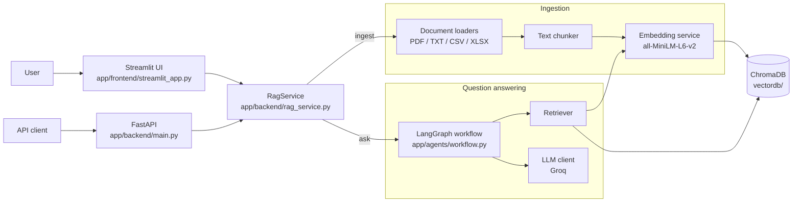
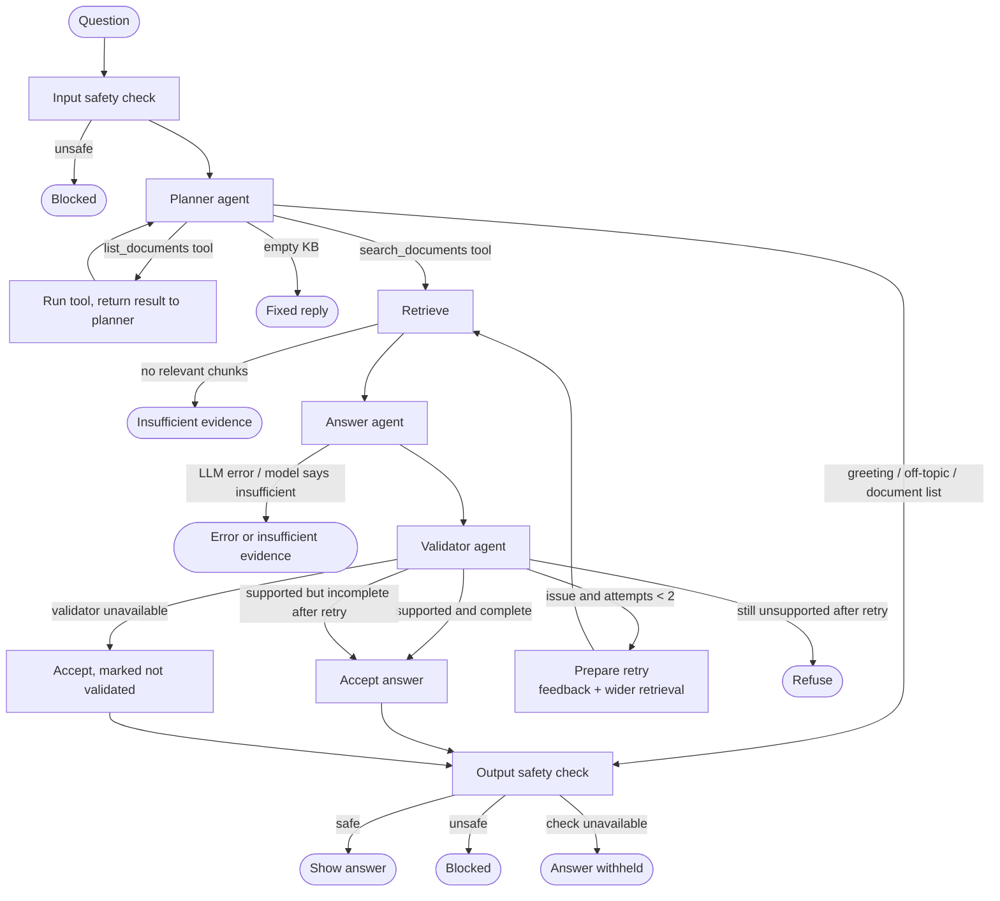

# Document AI Assistant - Project Documentation

**Generative AI and ML Capstone Project**
*An agentic AI-powered assistant that answers natural-language questions about enterprise technical documents.*

---

## 1. Overview

Document AI Assistant lets a user upload enterprise documents (PDF, TXT, CSV, Excel) and ask questions in natural language. The system:

1. Extracts and cleans text from the documents.
2. Splits the text into chunks and converts them into embeddings.
3. Stores the embeddings in a vector database (ChromaDB).
4. For each question, runs a **LangGraph multi-agent workflow**: a safety check screens the question, a planner agent chooses tools through the LLM's tool-calling API, relevant chunks are retrieved via semantic similarity search, an LLM (Groq) generates a grounded answer, and the answer is validated and safety-checked before it is shown.

Every answer cites the document excerpts it is based on (`[1]`, `[2]`, ...). If the documents do not contain the answer, the system says so instead of guessing. Unsafe questions and answers are blocked.

### 1.1 Capstone task coverage

| # | Capstone task | Implementation |
|---|---|---|
| 1 | Project foundation | Python 3.13 project, `requirements.txt`, `.env` configuration with validation (`app/core/config.py`), modular package structure |
| 2 | User interaction layer (UI or API) | Phone-friendly Streamlit chat UI (`app/frontend/streamlit_app.py`) **and** FastAPI REST API (`app/backend/main.py`) |
| 3 | Document ingestion (PDF, TXT, CSV, Excel) | `app/core/ingestion/` - one loader per format, content validation, friendly per-file errors |
| 4 | Prepare data for semantic search | `app/core/text_chunker.py` - cleaning, recursive chunking, row grouping for tables |
| 5 | Vector-based knowledge store | `app/core/embedding_service.py` (Sentence Transformers) + `app/core/chroma_store.py` (ChromaDB, cosine), stored in `vectordb/` |
| 6 | Intelligent retrieval | `app/core/retriever.py` - top-k similarity search with a minimum-score threshold |
| 7 | RAG pipeline | `app/agents/answer_agent.py`, `app/backend/rag_service.py`, `app/core/llm_client.py` |
| 8 | Agent-based reasoning using tools | `app/agents/` - LangGraph workflow: Planner (LLM tool calling over `app/agents/tools.py`), Retriever, Answer agent, Validator, bounded retry |
| 9 | Reliability and safety controls | Input/file validation, error mapping, citation enforcement, answer validation, refusal on insufficient evidence, prompt-injection mitigation, content-safety moderation of questions and answers (`app/agents/safety.py`) |
| 10 | Deploy and document | Hosted deployment is not required by the course instructor; the app runs locally (Section 8). Documentation: this document and `README.md` |

---

## 2. Technology Stack

| Component | Technology | Why |
|---|---|---|
| Language | Python 3.13 | Stable support for all ML libraries (3.14 lacked wheels for some) |
| UI | Streamlit | Fast to build an interactive web UI in pure Python |
| REST API | FastAPI + Uvicorn | Typed request/response models, automatic OpenAPI docs |
| PDF extraction | PyPDF | Pure Python, no system dependencies |
| CSV / Excel | Pandas, OpenPyXL | Standard tabular parsing |
| Chunking | langchain-text-splitters | Proven recursive splitter without pulling in full LangChain |
| Embeddings | Sentence Transformers `all-MiniLM-L6-v2` | Small, fast, CPU-friendly, good quality |
| Vector database | ChromaDB (persistent, cosine distance) | Local, file-based, no server needed |
| Agent framework | LangGraph | Explicit state graph with conditional routing and loops |
| LLM | Groq API, model `openai/gpt-oss-120b` | Free developer access, very fast inference, native tool calling |
| Content moderation | Groq API, model `openai/gpt-oss-20b` | Correct on all 10 evaluated safe/unsafe samples, with a higher free-tier rate limit than the dedicated safeguard model (see Section 11) |
| Testing | Pytest, Streamlit AppTest, FastAPI TestClient | Unit, integration, UI, and API tests |

---

## 3. System Setup

### 3.1 Prerequisites
- Windows 10/11 (also works on macOS/Linux with equivalent commands)
- Python 3.13
- A Groq API key (free at https://console.groq.com) - required only for generating answers; uploading works without it
- Internet access on first run (the embedding model, ~90 MB, is downloaded once to `%USERPROFILE%\.cache\huggingface`)

### 3.2 Installation (PowerShell)

```powershell
cd <project-folder>\document-ai-assistant
python -m venv .venv
.\.venv\Scripts\Activate.ps1
pip install -r requirements.txt
```

> If PowerShell blocks script activation, run `Set-ExecutionPolicy -Scope Process -ExecutionPolicy RemoteSigned` first.

### 3.3 Configuration

```powershell
Copy-Item .env.example .env
```

Edit `.env` and set at least `GROQ_API_KEY`. Never commit or share `.env`.

| Variable | Default | Meaning |
|---|---|---|
| `GROQ_API_KEY` | (none) | Groq API key; required for answers |
| `LLM_MODEL` | `openai/gpt-oss-120b` | Groq chat model |
| `MODERATION_MODEL` | `openai/gpt-oss-20b` | Groq model that classifies questions and answers as safe or unsafe |
| `EMBEDDING_MODEL` | `all-MiniLM-L6-v2` | Sentence Transformers model |
| `CHROMA_DIR` | `./vectordb` | Vector database folder |
| `CHUNK_SIZE` | 500 | Max characters per chunk |
| `CHUNK_OVERLAP` | 80 | Overlap between text chunks (must be < `CHUNK_SIZE`) |
| `MAX_FILE_MB` | 20 | Max size per uploaded file |
| `MAX_FILES` | 10 | Max files per upload |
| `TOP_K` | 5 | Chunks retrieved per question |
| `MIN_SCORE` | 0.2 | Minimum cosine similarity (0-1) for a chunk to be used |

Invalid values (e.g. non-numeric `CHUNK_SIZE`, overlap >= size) stop the app at startup with a clear message. Settings are read once at startup; restart the app after changing `.env`.

### 3.4 Running the application

**Web UI**
```powershell
python start_app.py
```
Open http://localhost:8501.

**REST API (optional)**
```powershell
python start_app.py api
```
Interactive API docs: http://localhost:8000/docs.

Don't run the UI and API against the same `CHROMA_DIR`: clearing the store in one breaks the other with a `NotFoundError` until it restarts. To run both, give the API its own folder first:
```powershell
$env:CHROMA_DIR = "./vectordb_api"
python start_app.py api
```

**Tests**
```powershell
python -m pytest
```
198 tests. 13 live test cases call the real Groq API and are skipped automatically when `GROQ_API_KEY` is not set.

### 3.5 Using the UI
The UI is a single-column chat that also works at phone width.

1. Under **Your documents**, tap **Try with sample files** or upload your own. Files are processed automatically, and any file that can't be read gets its own message.
2. Type a question in the box at the bottom. The box stays disabled until a document has been added.
3. The answer appears in the chat with citations. **Sources** shows the excerpts with the same numbers, and **How I got this answer** shows every step the agents took.
4. **Start a new chat** clears the conversation. **Remove all documents** (under **Your documents**) empties the vector database.

`README.md` lists sample questions and the output to expect.

---

## 4. Architecture

### 4.1 Component diagram



Text version of the flow:

```
Ingestion:  Upload -> validate -> extract text -> clean -> chunk -> embed -> ChromaDB
Question:   Question -> Safety check -> Planner (LLM chooses tools) -> Retrieve (embed query, similarity search)
                     -> Generate (LLM + citations) -> Validator -> accept | retry once with wider retrieval | refuse
                     -> Safety check on the accepted answer
```

### 4.2 Project structure

```
document-ai-assistant/
├── app/
│   ├── frontend/streamlit_app.py    Streamlit chat UI
│   ├── backend/
│   │   ├── main.py                  FastAPI REST API (/health, /documents, /upload, /ask, /reset)
│   │   └── rag_service.py           RagService facade used by the UI and API
│   ├── agents/                      LangGraph state, safety checks, tools, planner, answer agent, validator, workflow
│   └── core/
│       ├── config.py                .env loading and validation
│       ├── ingestion/               File validation and per-format loaders -> DocumentSection
│       ├── text_chunker.py          Cleaning and chunking -> Chunk (text + metadata)
│       ├── embedding_service.py     Sentence Transformers wrapper
│       ├── chroma_store.py          ChromaDB wrapper (add, replace, query, list, reset)
│       ├── retriever.py             Question validation + top-k search with score threshold
│       └── llm_client.py            Groq client with error mapping and tool calling
├── data/sample_documents/           Sample and invalid test files
├── vectordb/                        ChromaDB files, created as documents are added
├── docs/                            This document and screenshots
├── scripts/generate_samples.py      Regenerates the sample documents
├── tests/                           Pytest suite (198 tests)
├── .streamlit/config.toml           Streamlit settings (upload limit, simplified menu)
├── start_app.py                     Starts the UI or API from any folder
└── README.md, requirements.txt, pytest.ini, .env.example
```

Dependencies point one way: `frontend` and `backend` -> `agents` -> `core`. `core` imports nothing from the other layers.

### 4.3 Ingestion pipeline

| Step | Details |
|---|---|
| Validation | Allowed extensions `.pdf .txt .csv .xlsx`; empty files rejected; size limit (`MAX_FILE_MB`) and file count limit (`MAX_FILES`); content signatures checked (`%PDF-` header, ZIP header for XLSX) so renamed files are rejected; file names sanitised (no paths). Files are processed in memory and never written to disk. |
| Extraction | PDF: text per page (page number kept). TXT: UTF-8 with Windows-1252 fallback. CSV/XLSX: one record per row formatted as `column: value; ...` with sheet and row number. |
| Cleaning | Whitespace normalisation, hyphenated line-break rejoining, removal of empty content. |
| Chunking | Text: `RecursiveCharacterTextSplitter`, 500 characters with 80 overlap, preferring paragraph and sentence boundaries; PDF chunks stay within one page for exact page citations. Tables: rows grouped up to the chunk size, never split across sheets, with `row_start`/`row_end` metadata. |
| Embedding | Normalised `all-MiniLM-L6-v2` vectors (384 dimensions). |
| Storage | ChromaDB with cosine distance. Chunk id `"{source}:{index}"`; re-uploading a file deletes its old chunks first, so there are no duplicates. |
| Partial success | One bad file does not block the others; each failure is reported with a friendly message. |

### 4.4 Retrieval
The question is embedded with the same model, ChromaDB returns the `TOP_K` nearest chunks, and only chunks with similarity `score = 1 - cosine distance >= MIN_SCORE` are kept. Thresholds were calibrated on the sample documents (relevant chunks scored 0.31-0.56, unrelated 0.03-0.18).

### 4.5 Key design decisions

| Decision | Why | Alternative considered |
|---|---|---|
| LangGraph state graph | Explicit, testable decision points, and a trace of every step | Plain function with if/else |
| Native LLM tool calling in the planner | The LLM chooses tools and acts on their results | A JSON "action" field, which isn't real tool use |
| Validator with rule checks, then an LLM fact-check | Rules are free and catch format errors; the LLM catches unsupported claims | Only one of the two |
| At most 2 answer attempts, then refuse if unsupported | Self-correction with a fixed cost; refusing is safer than guessing | Unlimited retries |
| Safety checks on both question and answer | Harmful text from a document is grounded and cited, so the validator can't catch it | Input check only |
| Output safety check blocks the answer if it can't run | Nothing else checks the text before the user sees it | Showing the answer with a warning |
| 500-character chunks with 80 overlap | 800-character chunks mixed topics and lowered relevance scores | Token-based or semantic chunking |
| Rows grouped into chunks, with row numbers | Column names stay with values, and citations stay exact | Whole-table text |
| Embeddings computed by our own service | One explicit embedding path, with no extra model download by ChromaDB | ChromaDB's built-in embedder |
| Code split into `frontend`/`backend`, `agents`, and `core`, with dependencies pointing one way | Each layer is easy to find, test, and replace | Separate top-level packages |

---

## 5. Agent Roles and Workflow

The question-answering logic is a LangGraph `StateGraph` (`app/agents/workflow.py`). All agents share one state object (`app/agents/state.py`) and each step appends a line to a trace that is shown in the UI.



| Agent / node | File | Responsibility |
|---|---|---|
| **Input safety check** | `app/agents/safety.py` (`moderate_input`) | Classifies the question against the content-safety policy. Unsafe questions are blocked before any agent runs. If the check itself is unavailable, the workflow continues because the output check still applies. Skipped when the knowledge base is empty, since that path returns a fixed message. |
| **Planner** | `app/agents/planner.py`, `app/agents/tools.py` | Plans how to handle the message. If the knowledge base is empty it replies immediately (no LLM call). Otherwise the LLM chooses from the tools below through its native tool-calling API, or replies directly to greetings and off-topic requests. Tool results go back to the LLM, so it can act on them, for at most 3 turns. If the LLM fails or reaches no decision it falls back to retrieving with the original question, so real questions are never blocked. |
| **Retrieve** | `app/agents/answer_agent.py` (`retrieve`) | Runs semantic search. On a retry it doubles `top_k` and merges results for the rewritten query and the original question. |
| **Answer agent** | `app/agents/answer_agent.py` (`generate`) | Builds a prompt with numbered excerpts inside `<context>` delimiters and asks the LLM to answer **only** from them, citing every fact as `[n]`, or to reply with an `INSUFFICIENT_EVIDENCE` token. Normalises citation formats and extracts the cited excerpts. On a retry, the validator's feedback is added to the prompt. |
| **Validator** | `app/agents/validator.py` | Two layers. (1) Rule checks: the answer must contain citations and every citation must refer to an existing excerpt. (2) LLM fact-check: is every claim supported by the cited excerpts, and is any important information missing? Produces a structured verdict. |
| **Decision nodes** | `app/agents/workflow.py` | `prepare_retry` (max 2 attempts), `accept` (validated, supported-but-incomplete, or validator unavailable - flagged in the UI) and `refuse` (still unsupported after retry). |
| **Output safety check** | `app/agents/safety.py` (`moderate_output`) | Classifies every LLM-written answer or direct reply before it is shown. This catches harmful content from an uploaded document, which is correctly cited and would pass the validator. If the check is unavailable the answer is withheld. Fixed system messages skip this check. |

### 5.1 Planner tools

The LLM decides which tool to call; the application only runs the call the LLM requests. Tools are declared as JSON schemas in `app/agents/tools.py`.

| Tool | Purpose | How it runs |
|---|---|---|
| `search_documents(query)` | Semantic search over document content. The LLM writes a keyword-rich `query`. | Ends planning and passes `query` to the Retrieve node, which applies the score threshold and the wider search on retry. |
| `list_documents()` | Lists the indexed files and chunk count. | Runs inside the planner; the result goes back to the LLM, which can then reply or call `search_documents`. |

`app/backend/rag_service.py` (`RagService`) is the single facade used by both the UI and the API: `ingest()`, `search()`, and `ask()`. The LLM client is created lazily so uploading and searching work without an API key.

---

## 6. Reliability and Safety Controls

| Area | Control |
|---|---|
| Configuration | All settings validated at startup; secrets only in `.env`, which must stay out of the submission. |
| File input | Type allow-list, content signature checks, size and count limits, empty-file check, safe file names, in-memory processing (no path traversal), per-file error messages. |
| Question input | Empty and over-long (> 1000 characters) questions rejected in UI, API, and retriever. |
| Hallucination | Answers only from retrieved context; mandatory citations; LLM skipped when nothing relevant is retrieved; `INSUFFICIENT_EVIDENCE` refusal token; validator fact-check with bounded retry; unsupported answers refused; unvalidated answers shown with a warning. |
| Unsafe content | Every question and LLM-written answer is classified against a content policy (violence, weapons, self-harm, crime, malware, sexual content, hate). Ordinary technical and security content is explicitly allowed. Unsafe text is replaced by a fixed message and its sources are hidden. An unavailable check fails open on input and closed on output. |
| Prompt injection | Document text placed inside `<context>` delimiters with the tags stripped from document content; system rules state that excerpts and user messages are data, not instructions. Tested with `data/sample_documents/invalid/injection_test.txt`. |
| LLM errors | Groq errors (auth, rate limit, timeout, connection) mapped to friendly messages in `app/core/llm_client.py`; 30 s timeout, 2 retries, low temperature (0.1). |
| Error exposure | Unexpected exceptions are logged server-side; the UI and API show generic messages without stack traces or internal details. |
| Privacy | ChromaDB telemetry disabled; when run locally, documents stay on your machine and only questions, retrieved excerpts, and answers are sent to the LLM provider. Their embeddings and text are stored in `vectordb/`. |

---

## 7. REST API

| Endpoint | Method | Request | Response |
|---|---|---|---|
| `/health` | GET | - | `{"status": "ok", "app": ..., "llm_configured": bool}` |
| `/documents` | GET | - | Indexed file names and total chunk count |
| `/upload` | POST | multipart field `files` (one or more) | Chunk count per file and per-file errors. 400 too many files, 413 file too large, 422 nothing indexed |
| `/ask` | POST | `{"question": "..."}` | `status`, `answer`, `validated`, `attempts`, `sources` (file, label, score, text), `trace` |
| `/reset` | POST | - | Clears the knowledge base |

`status` is one of `answered`, `insufficient_evidence`, `responded` (direct planner reply), `blocked` (content-safety policy), or `error`.

---

## 8. Running and Submission

Hosted deployment isn't required for this submission, as confirmed by the course instructor. The application runs locally by following Section 3.

### 8.1 Submission zip
**Include:** `app/`, `data/`, `docs/`, `scripts/`, `tests/`, `.streamlit/config.toml`, `vectordb/README.md`, `README.md`, `start_app.py`, `requirements.txt`, `pytest.ini`, `.env.example`, and `.gitignore`.

**Leave out:** `.env` (contains the API key), `.venv/`, other `vectordb/` contents (they may hold your own documents), `chroma_db/`, `__pycache__/`, `.idea/`, `*.iml`, `.pytest_cache/`, and the capstone brief PDF.

After unzipping, follow Sections 3.2-3.4.

---

## 9. Testing

| Test file | Covers |
|---|---|
| `test_start_app.py` | Launcher commands and working folder |
| `test_settings.py` | Configuration defaults and validation errors |
| `test_ingestion.py` | Every loader, validation rules, signatures, encodings, partial success |
| `test_chunking.py` | Cleaning, chunk sizes/overlap, page and row metadata, chunk ids |
| `test_retrieval.py` | Embeddings, ChromaDB add/replace/delete/persist/reset, thresholds, end-to-end sample questions |
| `test_rag.py` | Prompt building, citation parsing, insufficient evidence, LLM error mapping, tool-call parsing, live Groq tests |
| `test_agents.py` | Planner tool loop, answer agent, validator, safety checks, routing, retry and refusal paths, live Groq tests |
| `test_app.py` | Chat UI: first screen, sample files, removing documents, chat history, sources, every answer status |
| `test_api.py` | All REST endpoints, upload limits, input validation |

Unit tests use fake embedders and mocked LLMs so they run fast and offline; a smaller set uses the real embedding model and the live Groq API. The phone layout, real file uploads, and the sample questions in `README.md` were also run in a real browser at 390x844; `phone-start.png` and `phone-answer.png` in `docs/screenshots/` come from that run. Automatic upload processing has no automated test, because Streamlit's test tool can't simulate file uploads.

---

## 10. Limitations

- **No OCR**: scanned or image-only PDFs have no extractable text and are rejected.
- **`.xls` not supported**: only `.xlsx` (legacy Excel needs an extra dependency).
- **Excel formulas** are read from cached values; workbooks saved without cached values show blanks.
- **Text encodings**: UTF-8 and Windows-1252 only; UTF-16 files are rejected.
- **PDF chunks never span pages**, so a paragraph crossing a page break is split in two.
- **Removing an upload**: taking a file out of the upload box doesn't remove it from the knowledge base. Use **Remove all documents**.
- **Same file name replaces**: uploading a different file with an existing name replaces the earlier one in the index.
- **Similarity thresholds** were calibrated on the sample documents only; very different document types may need tuning of `MIN_SCORE` and `CHUNK_SIZE`.
- **Prompt-injection defences reduce but do not eliminate** the risk.
- **LLM dependency**: answers need internet access and a valid Groq key; Groq rate limits apply. A typical question uses five LLM calls (input safety, planner, answer, validator, output safety) and a retry adds two more, which increases latency. Heavy use can exhaust the free-tier token limit, which causes long waits and, if the safety check cannot complete, withheld answers.
- **Validator and safety checks are themselves LLMs** and can occasionally misjudge text in either direction. For example, a live test answer stated a correct fact (the 30-minute session timeout) but cited the wrong excerpt number, and the validator accepted it.
- **No conversation memory**: the chat shows earlier questions, but each question is answered on its own, so a follow-up such as "what about its port?" loses its context. The app tells the user this.
- **Moderation covers questions and LLM-written answers only**: raw excerpts in the Sources panel are not moderated, and personal data in documents is not detected.
- **Planner replies are not grounded**: direct replies to greetings and off-topic messages are written by the LLM. They are safety-checked but not fact-checked.
- **Single-user local application**: no authentication, and all sessions share one knowledge base; chat history lives in the browser session only.
- **Upload limit is set in two places**: `MAX_FILE_MB` and `maxUploadSize` in `.streamlit/config.toml` (both 20 MB). Change them together.
- Changing `.env` requires restarting the app.

---

## 11. Challenges Faced and Solutions

| Challenge | What happened | Solution |
|---|---|---|
| Python version compatibility | Python 3.14 lacked pre-built wheels for some ML dependencies (torch, onnxruntime). | Standardised on Python 3.13. |
| LLM model availability | The initially planned Groq model `llama-3.3-70b-versatile` became Enterprise-only. | Verified available models through the Groq models API and switched to `openai/gpt-oss-120b`, configurable via `LLM_MODEL`. |
| Relevant content not retrieved | With 800-character chunks, the authentication section shared a chunk with other topics and scored 0.16 (below the 0.2 threshold), so a correct answer was never possible. | Reduced chunks to 500 characters / 80 overlap; the section now scores 0.56 while unrelated questions stay below 0.18. Documents must be re-indexed after changing chunk settings. |
| Citation format | `gpt-oss-120b` often cited with full-width brackets (`【1】`) or spaced brackets, which broke citation parsing. | Added citation normalisation before parsing and validation. |
| Correct but incomplete answers | Answers sometimes omitted details present in the documents. | Added the Validator agent with a completeness check and one retry using wider retrieval plus validator feedback. |
| Hallucination risk | LLMs tend to answer from general knowledge. | Strict context-only prompt, mandatory citations, `INSUFFICIENT_EVIDENCE` token, skip LLM when nothing is retrieved, LLM fact-check, refusal path. |
| Prompt injection in documents | A document could contain text such as "ignore previous instructions". | Context delimiters, tag stripping, explicit "data, not instructions" rules; dedicated injection test file. |
| Duplicate chunks on re-upload | Re-uploading a file added the same chunks again. | Deterministic chunk ids and delete-by-source before adding. |
| Unwanted downloads and telemetry | ChromaDB downloads its own ONNX embedding model by default and sends telemetry. | Embeddings computed explicitly by our service (`embedding_function=None`); telemetry disabled. |
| Repeated LLM calls in Streamlit | Streamlit reruns the whole script on every widget interaction, which would re-ask the LLM. | Chat history stored in session state, so an answer is generated only once; heavy services cached with `st.cache_resource`. |
| Moderation rate limits | The dedicated `openai/gpt-oss-safeguard-20b` model allows only 2,000 tokens per minute on the account used, so 10 checks took 172 s of waiting and retries. | Compared models on the same safe and unsafe samples: `openai/gpt-oss-20b` was equally accurate (10/10) with an 8,000 limit and took 7 s. Made it the default, configurable via `MODERATION_MODEL`. |
| Harmful content inside documents | A harmful uploaded document produces an answer that is grounded and correctly cited, so the validator accepts it. | Added an output safety check after validation; tested live with a harmful document. |
| Over-blocking technical content | Technical documents use words like "kill", "injection", and "token". | The safety policy explicitly allows ordinary technical and security content; live tests cover these cases. |
| Off-topic requests with tool calling | With a loose prompt, the planner wrote a poem instead of declining. | Stricter planner prompt with a live test for off-topic requests. |
| UI too technical for non-experts | The first UI had a sidebar, a separate processing step, similarity scores, and debug panels, which suited developers but not phone users. | Rebuilt it as a single-column chat with automatic processing and plain labels, then checked it in a browser at phone size. |
| Circular imports | `rag_service -> workflow -> answer_agent` created import cycles. | Moved prompt and citation helpers into `app/agents/answer_agent.py` and shared state into `app/agents/state.py`. |
| Testing without cost or network | Real model and LLM calls are slow and need an API key. | Fake embedder and mocked LLM for most tests; small set of live tests skipped when no key is set. |

---

## 12. Future Improvements

- OCR for scanned PDFs (e.g. Tesseract) and `.xls` support.
- Hybrid retrieval (keyword + semantic) and a re-ranking model.
- Conversation memory, so that follow-up questions work.
- Authentication and per-user document collections.
- Hosted deployment.
